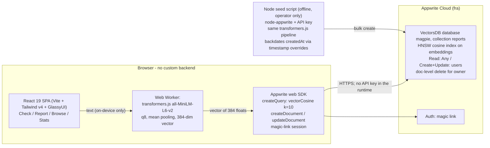

# Magpie 🐦‍⬛

**Community scam-message radar.** Paste any SMS, email, or WhatsApp message → it gets embedded **in your browser** and matched against a crowd-sourced corpus of reported scams. Get a verdict, a match score, and the matching reports — even for paraphrased variants that defeat keyword blocking.

> The magpie collects shiny things. This one collects scams.

## Status

🚧 **Work in progress** — being built for the [Appwrite Databases Hackathon](https://hackathon.appwrite.io/) (Oct 19–31, 2026). All code in this repository is written during the hackathon window.

## How it works (in one breath)

Your message text never leaves your device: an embedding model (all-MiniLM-L6-v2, 384 dims) runs locally via transformers.js in a Web Worker. Only an opaque vector is sent to **Appwrite VectorsDB**, where an HNSW cosine index ranks the community's scam reports by semantic similarity. High similarity → HIGH RISK verdict, with the matching reports, categories, and report counts.

## Architecture

The shape matches the PRD's core-architecture sketch (§6 of [`.agents/PRDs/PRD.md`](.agents/PRDs/PRD.md)): everything persistent lives in one VectorsDB database, the browser talks to it directly, and the only server-side key sits in the offline seed script.



Key facts, each enforced in code rather than aspirational:

- **No custom backend.** All data access is the Appwrite web SDK from the browser, gated by collection permissions — zero API keys in the runtime; the only server key lives in the offline seed script's gitignored `.env.local`.
- **One database.** Everything persistent is the single VectorsDB database `magpie` → collection `reports` ([`src/lib/appwrite.ts`](src/lib/appwrite.ts)) — the hackathon's one-database rule is compliance by design, not by discipline.
- **Embedding boundary.** Every embedding goes through [`src/lib/embedder.ts`](src/lib/embedder.ts) (`embed(text)` → 384-dim vector); the documented one-file swap to Appwrite's built-in `createTextEmbeddings` is the only alternative, and embedding sources are never mixed inside one corpus.
- **Transport.** The kNN call posts `createQuery` with `Query.vectorCosine` + `Query.limit(10)` ([`src/lib/search.ts`](src/lib/search.ts)) — `listDocuments`' GET form URL-embeds the queries, one 384-dim vector is ~3.5k chars, and Appwrite rejects such URIs with HTTP 414 before the API is reached.
- **`$distance` semantics.** VectorsDB returns cosine *distance*; every consumer thinks in similarity via `similarity() = 1 − distance` ([`src/lib/constants.ts`](src/lib/constants.ts)). Metadata filters use dot-notation (`metadata.category`, `metadata.hidden`), but metadata is not orderable — so the feed sorts on the system field `$createdAt` ([`src/lib/feed.ts`](src/lib/feed.ts)) and the seed backdates it via timestamp overrides ([`scripts/seed.ts`](scripts/seed.ts)).

## Why VectorsDB is the right database

Four reasons, each anchored in shipped code rather than preference:

1. **kNN is a query, not code.** Paraphrase-resistant scam matching is the product thesis, and VectorsDB makes it one `Query.vectorCosine` call against the collection's HNSW cosine index ([`src/lib/search.ts`](src/lib/search.ts)) — no self-hosted vector store, no custom backend, no cosine loop anywhere in the app. The committed 80-variant tuning set is the measured proof: `npm run tune` shows 71/80 reworded scams clear the `SUSPICIOUS` boundary (see [Thresholds](#thresholds)).
2. **The corpus is the database.** The same `reports` collection serves check search, dedupe-merge ([`src/lib/reports.ts`](src/lib/reports.ts)), the public feed ([`src/lib/feed.ts`](src/lib/feed.ts)) and corpus stats ([`src/lib/stats.ts`](src/lib/stats.ts)) — one database for everything persistent, which is exactly the hackathon's single-database rule.
3. **Schemaless metadata, used in-band.** Reports are free-form JSON payloads filtered with dotted string queries — `notEqual('metadata.hidden', 'true')` powers hide-own ([`src/lib/feed.ts`](src/lib/feed.ts), [`src/lib/stats.ts`](src/lib/stats.ts)), `equal('metadata.category', …)` powers the per-category stats counts. The one real constraint — metadata cannot be ordered — is designed around with `$createdAt` sorting plus seeded timestamp backdating, not fought.
4. **Permissions are the security boundary.** Collection `read("any")` (public radar), `create("users")` (only signed-in users report), `update("users")` (the merge path) and per-document `delete("user:<uid>")` (only the author can remove their own report) are configured on the collection ([`scripts/setup-db.ts`](scripts/setup-db.ts)) — no server-side authorization code exists at all, because the database itself enforces the model.

What we considered instead: keyword/regex blocklists are defeated by exactly the reworded variants this corpus exists to catch; Postgres + pgvector (or a separate vector service) would require a custom backend and break the one-database rule; and client-side brute-force cosine over all 360 × 384 floats would ship the whole corpus to every phone — bandwidth and latency that VectorsDB's HNSW does server-side in one query.

## Stack

- **Vite + React 19** + TypeScript + Tailwind CSS v4
- **GlassyUI** (shadcn-style glass component registry)
- **Appwrite VectorsDB** — the corpus *is* the database: embeddings, kNN search, dedupe-merge, feed, stats
- **Appwrite Auth** (magic link) — required only to report
- **transformers.js** — client-side embeddings, no LLM, no paid API anywhere

## Getting started

Clone the repo, then:

```bash
npm install
npm run dev
```

The SPA serves at `http://localhost:5173` (or `$PORT` when set). `/` is the **check screen**: paste a message (capped at 1,000 characters, with a live counter and a truncation note), hit **Check**, and the verdict card answers with a tier badge, the top matches (snippet, category/channel/region chips, report count), and 0–100% similarity bars. `/check` is the embedder debug surface (on-device embedding with a live progress log); `/health` renders a JSON health panel with `{"status":"ok","appwrite":"reachable"|"unreachable"}` based on a real `listDocuments` call against VectorsDB. `/browse` is the anonymous recent-reports feed — 25 newest non-hidden reports per page (text snippet, category/channel/region chips, report count, relative age) with Prev/Next pagination, topped by a stats strip showing the corpus total, the last-7-days count, one count per category, and a top-category callout. Reports you created yourself carry a Hide button — the app's only moderation: a confirm-guarded soft-hide that sets the document's `metadata.hidden` to `"true"`, removing it from the feed for everyone without touching the stored vector.

Two ways to serve:

- `npm run dev` — the Vite dev server (`npm install` first).
- `npm start` — `node server.mjs`, a zero-dependency static server for the committed production build (`dist/`). Answers instantly on a fresh clone with no registry round-trip, which is what CI-style checks use; identical routes and SPA catch-all behavior through the same `index.html`.

A production build is available via `npm run build`.

## Environment

- `.env` — committed, public-by-design client values (`VITE_APPWRITE_ENDPOINT`, `VITE_APPWRITE_PROJECT_ID`); these ship in the browser bundle.
- `.env.local` — gitignored, operator-only secrets (Appwrite API keys). Never commit.
- `.env.example` — template documenting every key with empty values. Copy it to `.env` and fill in your project's values.

## Appwrite bootstrap (one-time, Console)

Until this one-time setup is done, `/health` renders `"appwrite":"unreachable"` — that is the graceful, expected state for a fresh environment. The scripted alternative is `npm run setup:db` — see [Database setup](#database-setup) below.

1. In the [Appwrite Console](https://cloud.appwrite.io/console), pick the **fra** region and create (or open) the project, then add a **Web platform** with hostname `http://localhost:5173` so browser calls pass CORS. Any other origin used by a test harness or preview deploy must be registered as a **Web platform** too, or all browser calls fail CORS.
2. Under **VectorsDB**, create a database with ID `magpie`.
3. Inside that database, create a collection with ID `reports` and give it **Read** permission `Any`.
4. Copy the endpoint and project ID from the project settings into `.env`, restart the dev server, and reload `/health` — it should now read `"appwrite":"reachable"`.

## Database setup

The Console steps above can be replaced by an idempotent script: `npm run setup:db` creates everything the app needs and can be re-run safely (it detects existing resources and leaves them untouched).

It provisions:

- VectorsDB database **`magpie`**, collection **`reports`** with vector field **`embeddings`** (dimension **384**, Custom — not the Console's model binding) and an **HNSW index with cosine metric** on it
- collection permissions: **Read: Any**; **Create / Update: users** (plus document security, so reports can carry doc-level `delete("user:<uid>")` permissions — the template is printed by the script and applied per document at write time by the report flow, because doc-level permissions cannot be set by a provisioning script)
- metadata fields per the PRD schema (text, category, channel, region, first_seen, reporter_id, hidden, report_count) live inside each document's JSON payload

### 1. Configure the .env key

The script is the only thing that talks to Appwrite with a key — laps and CI never have one, so this step is operator-only. Copy `.env.example` to `.env.local` (gitignored) and fill in:

```bash
cp .env.example .env.local
# then edit .env.local:
#   APPWRITE_ENDPOINT    https://fra.cloud.appwrite.io/v1
#   APPWRITE_PROJECT_ID  your project id
#   APPWRITE_API_KEY     an API key with the scopes below
```

The `.env` file that is committed is public-by-design (client values only) — **never put the API key in `.env`**; `.env.local` stays gitignored and operator-only.

The key must have the **`vectorsdb`** and **`documents`** scopes (create it in Console → project → *Integrations* → API key).

### 2. Run it

```bash
npm install
npm run setup:db
```

Output shows `created` for every resource the first run makes and `exists` when it is already provisioned; the permission wire strings (`read("any")`, `create("users")`, `update("users")`) and the document-level `delete("user:<uid>")` template are printed at the end for reference.

### 3. Load the seed corpus

Populate the collection with the committed scam corpus ([`data/seeds/corpus.jsonl`](data/seeds/corpus.jsonl), 360 lines):

```bash
npm run seed
```

Same `.env.local` variables as step 1 (`APPWRITE_ENDPOINT`, `APPWRITE_PROJECT_ID`, `APPWRITE_API_KEY` — the key needs the **`vectorsdb`** and **`documents`** scopes). Like `setup:db`, this step is **operator-only**: CI and laps never hold the key.

For every line the script embeds the text **on-device** with the same quantized `Xenova/all-MiniLM-L6-v2` model the browser uses (384 dims, q8, mean pooling, normalized — one shared cosine space), then creates one document with the vector plus the line's metadata (`text`, `category`, `channel`, `region`, `first_seen`, `report_count`) and **overscribes `$createdAt` with `first_seen`** so the feed's date sort reads realistic ages (the override is verified on the first insert and the run aborts if the server ignores it).

One-time model note: the first run downloads the quantized model weights (~23 MB) into transformers.js's HTTP cache (`.cache/`, gitignored) — the same fetch the browser does on first use.

Seeding is idempotent: a gitignored `.seed-checkpoint.json` at the repo root records every line already inserted (keyed by the full SHA-256 of its text), so an interrupted or repeated run skips what is done; deterministic document IDs (`seed-<text-hash>`) are the second layer — even if the checkpoint is deleted, already-seeded lines return 409 and are recorded, never duplicated.

## Seed corpus

The scam corpus the app matches against ships as committed seed data: [`data/seeds/corpus.jsonl`](data/seeds/corpus.jsonl) — **360 anonymized scam texts** (180 dataset-modeled + 100 hand-written Nigerian-context originals + 80 reworded tuning variants). One JSON document per line:

```json
{"text": "GTBANK ALERT: ...", "category": "phishing", "channel": "sms", "region": "Lagos", "first_seen": "2026-08-01T00:00:00.000Z", "report_count": 3, "source": "hand-written Nigerian-context seed (original, no PII)"}
```

- `category` ∈ `phishing | investment | advance_fee | delivery | romance | job_offer | other` and `channel` ∈ `sms | whatsapp | email` — the same vocabularies as [`src/lib/constants.ts`](src/lib/constants.ts).
- `first_seen` is a full ISO-8601 UTC timestamp, 32–220 days old at build time (the final drop into VectorsDB is operator-side, so seed ages track the "first reported …" UI correctly).
- `report_count` is 1–90 and concentrated: 25 flagged "popular" scams carry 25–90, the rest skew low (1–14) — the merge/dedupe flow (`#9`) increments counts from there.
- Variant lines carry one extra key, `"variant_of": <line index>` (0-based, pointing back at the base line they paraphrase). They exist as the paraphrase set for threshold tuning; 80 lines qualify, ≥ 60 required — validated with `npm run tune`, see [Thresholds](#thresholds).
- Privacy: no real addresses (all mails are `…@example.com`), phone numbers only as masked patterns (`+234xxxxxxxxxx`, `0803xxxxxxx`), no quoted headers, each text ≤ 990 chars.
- All texts are **modeled** on the public sources below — no verbatim upstream excerpts are copied, so the committed corpus carries no third-party prose and no PII leak from those datasets. `source` names the dataset each line is modeled on.

Rebuild or validate it with two scripts (`scripts/build-corpus.ts`, deterministic — same UTC day, same output):

```bash
npm run corpus:build   # assemble the sources into data/seeds/corpus.jsonl
npm run corpus:check   # re-run the full acceptance contract + regeneration diff
```

`corpus:check` verifies line counts, key sets, vocabularies, PII rules, variant indexing and the backdating window, and byte-compares every field against a fresh in-memory regeneration. Author new lines in `data/seeds/sources/handwritten.ts` (or extend a dataset pool) — quotas and category splits are asserted at build time.

Per-source names and licenses: see [Dataset attribution](#dataset-attribution).

Insertion into VectorsDB is operator-side: `npm run seed` (see [Database setup](#database-setup), step 3) — embedding the lines and backdating `$createdAt` both need the operator's API key, which laps never hold.

## Dataset attribution

Framing first, because two properties matter as much as the names:

- All 360 lines are **modeled**, never verbatim upstream prose — no third-party text ships in the repo and no PII leaks from these datasets (rules asserted by `npm run corpus:check`).
- Per-source counts below are **base lines only**: 280 base lines (180 dataset-modeled + 100 hand-written). The 80 reworded tuning variants are not counted in the rows — each variant inherits its parent's `source` ([`scripts/build-corpus.ts`](scripts/build-corpus.ts)), and they split 40/40 between dataset parents and hand-written parents. 280 + 80 = the committed 360.

| Source | Modeled as | License |
|---|---|---|
| UCI SMS Spam Collection | 75 sms prize/lottery/quiz texts | CC BY 4.0 (UCI page) |
| Apache SpamAssassin public corpus | 42 email phish/pump/419 texts, headers stripped | free for research (Apache SpamAssassin) |
| `rokibulroni/Phishing-Email-Dataset` → `Nigerian_Fraud.csv` | 26 classic 419 letters | CC BY-SA 4.0 (repo readme) |
| `rokibulroni/Phishing-Email-Dataset` → `Nazario.csv` | 16 verify-within-24h phish | CC BY-SA 4.0 |
| [`electricsheepafrica/africa-smishing-sms-phishing`](https://huggingface.co/datasets/electricsheepafrica/africa-smishing-sms-phishing) (Hugging Face) | 21 Nigerian bank-app/BVN/promo SMS | repo license (Hugging Face) |
| Hand-written Nigerian-context originals | 100 original texts | original |

## Deploying (Vercel)

The SPA deploys to Vercel's static hosting with zero configuration beyond the SPA rewrite the repo already ships ([`vercel.json`](vercel.json)). Runbook:

1. **Check the SPA rewrite.** [`vercel.json`](vercel.json) carries exactly one catch-all rewrite — `{"source": "/(.*)", "destination": "/index.html"}` — so hard navigation and refreshes on `/browse`, `/report`, and the magic-link callback `/auth/callback` (all [`src/App.tsx`](src/App.tsx) routes) answer `index.html`. There is no serverless function; nothing else is required.
2. **Import the repo in Vercel.** Framework preset **Vite**, build command `npm run build`, output directory `dist` — Vercel's Vite preset fills these in from `package.json`; confirm them.
3. **Set the project env vars.** Only the public-by-design client values `VITE_APPWRITE_ENDPOINT` and `VITE_APPWRITE_PROJECT_ID` — the same keys as [`.env.example`](.env.example); they ship in the browser bundle by design. **Never add the Appwrite API key** — it exists only in the operator's gitignored `.env.local` and never belongs in any deployment.
4. **Deploy.** Every push to the connected repo deploys, or from the command line: `npx vercel --prod`. When it answers, the deploy URL should render the check screen exactly as `npm start` serves the committed build.
5. **Register the domain as an Appwrite Web platform (CORS).** Add the production domain in the Appwrite Console as a **Web platform** — the same step as the `http://localhost:5173` platform in [Appwrite bootstrap](#appwrite-bootstrap-one-time-console) — or every browser call fails CORS. Then verify the magic-link round-trip on the production domain: the login flow computes its redirect URL as `${window.location.origin}/auth/callback` ([`src/routes/login.tsx`](src/routes/login.tsx)), so the deployed origin's `https://<your-domain>/auth/callback` must be reachable and registered as the magic-link redirect — the callback route turns the link's token into a session and returns the user to the signed-in app.

Before recording the demo, run the end-to-end acceptance probe — `npm run smoke` proves the seeded corpus answers the check flow the way the deployed app will: [Smoke check](#smoke-check).

## Smoke check

One command, two phases, and the operator's checklist before recording the demo — `scripts/smoke.ts` probes the **live, seeded project** exactly the way the acceptance contract pins it (issue #20):

```bash
npm run smoke                 # operator run: needs .env.local (APPWRITE_ENDPOINT / APPWRITE_PROJECT_ID / APPWRITE_API_KEY) and a seeded project
npm run smoke -- --local      # offline gate: no key, no network — the slice laps and CI can run
```

What it checks, in order — every line prints its **measured value and the bar it cleared**, and the script exits 0 only when all run probes pass (final line `SMOKE OK`, or `SMOKE LOCAL OK` for `--local`):

1. **Seed present** (offline + online): the committed corpus (`data/seeds/corpus.jsonl`, 360 lines, 80 `variant_of` pairs) loads and validates; online, the corpus must hold ≥ **300** non-hidden documents — the feed-total probe runs `listDocuments` with `Query.notEqual('metadata.hidden','true')` **verbatim from [`src/lib/feed.ts`](src/lib/feed.ts)** and reads the server's `total` (the [`src/lib/stats.ts`](src/lib/stats.ts) count idiom).
2. **kNN sane for 3 texts** (online, one POST `createQuery` per text, k=10 — the app's own transport, see below):
   - **Known scam** (corpus line 1) → retrieves its **own** seed document (deterministic ID `seed-<sha256[:20]>`, [`scripts/seed.ts`](scripts/seed.ts)) with similarity ≥ `THRESHOLDS.HIGH` (**0.90**);
   - **Paraphrased variant** → the strongest `variant_of` pair the corpus itself certifies (chosen offline by argmax over all 80 pairs, ties to the lowest line index) retrieves its **source** document in the top-10 with similarity ≥ **0.80** (the issue-pinned retrieval bar, distinct from any `THRESHOLDS` value);
   - **Benign control** → a plain everyday message's top-1 similarity stays **< `THRESHOLDS.SUSPICIOUS` (0.65)** — the guard against false verdicts.
3. **Thresholds recorded**: the run header echoes `THRESHOLDS` — `HIGH=0.90 · SUSPICIOUS=0.65 · MERGE=0.95` — read live from [`src/lib/constants.ts`](src/lib/constants.ts), never restated inside the script, so the probe always measures against the currently tuned boundaries.
4. **Deploy runbook enumerated**: with smoke green, the recording checklist is exactly the five numbered steps of [Deploying (Vercel)](#deploying-vercel) — ① SPA rewrite present, ② repo import, ③ `VITE_APPWRITE_ENDPOINT` / `VITE_APPWRITE_PROJECT_ID` env vars, ④ deploy, ⑤ Appwrite Web-platform registration + magic-link redirect `https://<your-domain>/auth/callback`.

Transport note (mirrors [`src/lib/search.ts`](src/lib/search.ts)): the three vector probes ride the **POST** route `vectors.createQuery` — `listDocuments` fetches GET with queries URL-embedded, and one 384-dim `vectorCosine` query is ~3.5k chars, which Appwrite rejects with HTTP 414 before the API is reached. The vector-free feed-total probe rides GET `listDocuments` — the same split the app itself makes (`search.ts` POST, `feed.ts`/`stats.ts` GET).

Latest recorded local gate (no key needed): **strongest pair corpus line 316 → 266, local cosine 0.9078 ≥ 0.80, probe texts embedded, `SMOKE LOCAL OK`** — followed by the online probes on the operator's seeded project.

## Thresholds

The check flow's verdict boundaries are three constants in [`src/lib/constants.ts`](src/lib/constants.ts) (`THRESHOLDS`) — and they live nowhere else, so a tuning pass never touches a call site:

| Threshold | Value | What gates on it |
|---|---|---|
| `HIGH` | 0.90 | Verdict tier **HIGH RISK** (similarity ≥ 0.90) — a near-verbatim copy of a reported scam |
| `SUSPICIOUS` | 0.65 | Verdict tier **SUSPICIOUS** (0.65–0.89) — the "reworded scam still caught" floor; below it the check card shows the no-prior-reports panel |
| `MERGE` | 0.95 | Dedupe-before-write in the report flow ([`src/lib/reports.ts`](src/lib/reports.ts)): a new report ≥ 0.95 similar to an existing one **merges** into it (report count +1) instead of creating a near-duplicate document |

They are tuned against the corpus's held-out reworded variants (issue #16): `npm run tune` embeds all 80 `variant_of` pairs with the same on-device model the browser uses and scores each variant against its source.

Final state after the tuning run:

- **`SUSPICIOUS` 0.80 → 0.65.** Measured variant sims span 0.30–0.91 (median 0.79, p05–p95 = 0.47–0.88) — wider than the PRD's 0.75–0.88 risk estimate — while unrelated-text pairs measure far lower (median ~0.13 in a 240-pair corpus sample; same-category, different-narrative pairs reach only ~0.40). At the original 0.80, only 34/80 (42.5%) of true rewordings score above the boundary. The tuner's mechanical p20 rule — the boundary that keeps at least 80% of pairs, floored to a 0.05 step — measured p20 = 0.69 and suggested **0.65**, still 0.25 above the same-category different-narrative ceiling; at 0.65, 71/80 (**88.75%**) clear it, meeting the issue's ≥ 80% bar with the boundary far from the noise. `HIGH` and `MERGE` stay put: only 2/80 variants reach 0.90 (near-verbatim copies only) and none reach the 0.95 merge band, which is exactly what those tiers mean.
- **Below the boundary by measurement, not massage.** The 9 variants under 0.65 are the corpus's loosest rewrites — mostly pidgin-heavy romance/419 continuations that share the *scenario* with their source but almost none of the wording. Chasing them would push `SUSPICIOUS` toward the unrelated-text noise floor, so the boundary stays at the p20-suggested 0.65 and the tuner's distribution line reports that tail instead.

Re-run the measurement any time — it needs **no Appwrite key and no database** (it computes cosines locally), and its first run downloads the quantized model (~23 MB) into the gitignored `.cache/` just like the browser does on first use:

```bash
npm run tune
```

Each variant prints one line — `variant <0-based line index>: sim=<score> tier=<HIGH_RISK\|SUSPICIOUS\|NO_REPORTS>` — followed by a summary line (pass rate against `SUSPICIOUS`), the similarity distribution, the size of the merge band, and a data-driven `suggest:` verdict on the thresholds.

## Performance

The PRD's quality indicator is a **Lighthouse mobile performance score ≥ 85** for the core loop (load → check → verdict), measured against the committed production build served by `npm start` (the same surface the grading probe and any deployment see).

Operator command (Lighthouse CLI defaults to mobile emulation on a throttled Slow 4G network):

```bash
npm start                                          # serves the committed dist/ on :5173
npx --yes lighthouse http://127.0.0.1:5173/ \
  --only-categories=performance \
  --output=json --output-path=lighthouse.json \
  --chrome-flags="--headless --no-sandbox"
```

**Latest recorded run:** performance **99 / 100** (Lighthouse 13.5.0, mobile emulation + Slow 4G throttling, chrome-headless-shell 156.0.8078.47, against `npm start` serving the committed `dist/` — FCP 1.7 s, LCP 1.7 s, TBT 0 ms, CLS 0, Speed Index 1.7 s). The gate — mobile performance ≥ 85 — passes with headroom; re-run the command above whenever `dist/` changes and record the new score here.

Levers already shipped for the score (issue #18):

- **Gzip on the static server** ([`server.mjs`](server.mjs)): the ~498 KB JS bundle and ~122 KB CSS transfer ~4–6× smaller over the wire when the client sends `Accept-Encoding: gzip` — the single largest render-blocking payload on the page.
- **Deferred model load**: the 21.6 MB `.wasm` / ~23 MB quantized model is fetched by the Web Worker only when the embedder first runs (post-load warmup, see `src/lib/embedder.ts`) — it is never in the critical path of first paint or TTI.
- **No blocking webfonts, no blocking images**: the page is system-font text; the only image is a ~500 B inline-icon SVG favicon.
- **Text-only LCP**: the pre-hydration shell in [`index.html`](index.html) is plain HTML, so the largest contentful paint lands from markup alone, before any JS parses.

## Limitations

Stated as shipped — these are the tradeoffs the current build makes, not open bugs.

- **~256-token truncation.** The on-device embedding model reads roughly the first ~256 tokens of a message; the paste box's 1,000-character cap ([`src/routes/home.tsx`](src/routes/home.tsx)) does not guarantee that everything fits, because verbose multi-word scripts tokenize long. Matches past the cut are invisible to the search — and the UI says so on the paste box itself ("Long input is capped at 1,000 characters; the embedding model reads roughly the first ~256 tokens").
- **Any signed-in user can merge-increment (accepted tradeoff).** The collection-level `update` permission `update("users")` lets every signed-in user run the merge path's `updateDocument` on *any* report and bump its `report_count` ([`src/lib/reports.ts`](src/lib/reports.ts)) — that permission is what makes crowd-sourced dedupe possible without a backend, and Sybil inflation of counts is accepted, not mitigated (PRD §9: "Update needed so any signed-in user can merge-increment; accepted tradeoff"). Only deletes are doc-scoped — `delete("user:<uid>")` on each report — so no one can remove another user's report.
- **No moderation beyond hide-own.** The only moderation surface is a reporter's own soft-hide (`metadata.hidden` = `"true"` via `hideReport()`, [`src/lib/reports.ts`](src/lib/reports.ts)); there is no admin panel, review queue, or takedown flow, and the PRD's scope explicitly excludes one.

The standing honesty rule: "no prior reports" always means *unseen*, never *safe*.

## Plans

The full product requirements document lives in [`.agents/PRDs/PRD.md`](.agents/PRDs/PRD.md) (architecture, data model, milestones, demo script).
