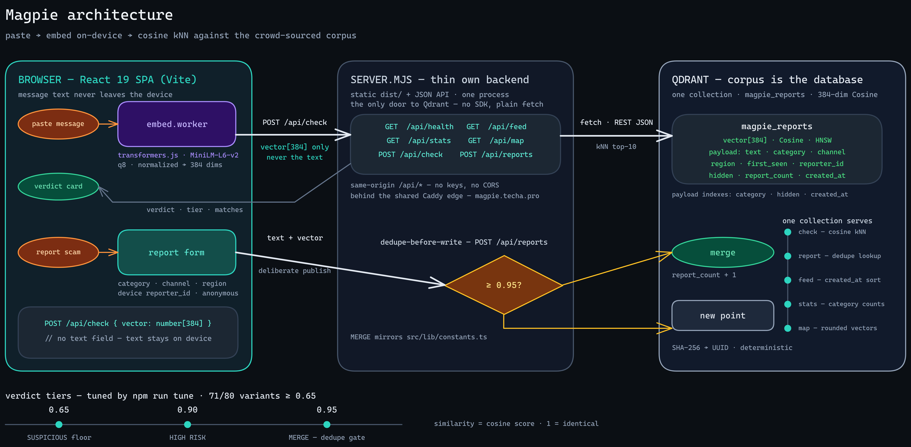

<div align="center">


# Magpie

*Community scam-message radar — paste a suspicious message, get a verdict.*

[](https://react.dev)
[](https://www.typescriptlang.org)
[](https://vite.dev)
[](https://tailwindcss.com)
[](https://qdrant.tech)
[](#performance)

**[How it works](#how-it-works) • [Architecture](#architecture) • [Getting started](#getting-started) • [Configuration](#configuration) • [The corpus](#the-corpus) • [Thresholds](#verdict-thresholds) • [Smoke check](#smoke-check) • [Performance](#performance) • [Deployment](#deployment) • [Limitations](#limitations)**

</div>

Magpie matches the message on your screen against a crowd-sourced corpus of reported scams — **semantically**, so paraphrased variants that defeat keyword blocking still get caught. The corpus is the database: every check, report, dedupe, feed and stat rides one Qdrant collection.

> The magpie collects shiny things. This one collects scams.

> [!IMPORTANT]
> "No prior reports" always means *unseen*, never *safe*. The honest result is part of the product, not a failure state.

## How it works

1. **Paste** a suspicious SMS, email or WhatsApp message (capped at 1,000 characters — the embedding model reads roughly the first ~256 tokens, and the paste box says so).
2. **Embed on-device.** transformers.js runs `all-MiniLM-L6-v2` (quantized, 384 dims) in a Web Worker. Only an opaque vector is ever sent anywhere — check submissions transmit no text at all.
3. **Match.** The backend runs a cosine kNN (k=10) against the community's scam reports in Qdrant.
4. **Verdict.** HIGH RISK (similarity ≥ 0.90) · SUSPICIOUS (0.65–0.89) · or the no-prior-reports panel with a one-tap, pre-filled **Report this message** CTA — the corpus grows from exactly the checks that found nothing.
5. **Report (optional, anonymous).** Message + category/channel/region; a near-duplicate submission merges into the existing report instead of polluting the corpus.

## Features

- **Paraphrase-resistant matching** — semantic kNN catches reworded scams, not just keyword copies.
- **Privacy by architecture** — embeddings run in your browser; text never leaves the device on a check.
- **Dedupe-before-write** — reports ≥ 0.95 similar fold into the existing entry (`report_count + 1`), so one widespread scam shows as one report: "merged — now 48 reports".
- **Anonymous reporting** — no accounts anywhere; a device-local random id drives hide-own-report, the app's only moderation.
- **Live feed + stats** — the 25 newest reports, corpus total, last-7-days count, per-category breakdown and a top-category callout.
- **Vector map** — the whole corpus as a force-directed constellation, positioned by pairwise similarity.
- **Dark-first glass UI** — a token-driven design system; the light theme flips as a whole, and every animated surface settles under reduced motion.

## Architecture



*The editable source lives at [`docs/architecture.excalidraw`](docs/architecture.excalidraw).*

Key facts, each enforced in code rather than aspirational:

- **One collection is the whole database.** Every persistent thing is a point in `magpie_reports`: the vector powers kNN search and dedupe-merge, the payload powers feed and stats ([`server.mjs`](server.mjs)).
- **A thin backend is the only door to Qdrant.** The browser never talks to the vector database. The zero-dependency Node server ([`server.mjs`](server.mjs)) serves the built SPA and the JSON API (`/api/check`, `/api/reports`, `/api/feed`, `/api/stats`, `/api/map`, `/api/health`) from one process — no SDK packages, Qdrant's REST API is plain JSON over `fetch`.
- **Embedding boundary.** Every embedding goes through [`src/lib/embedder.ts`](src/lib/embedder.ts) (`embed(text)` → 384-dim vector), computed on-device in [`workers/embed.worker.ts`](workers/embed.worker.ts). The documented one-file swap to a server-side embedder is the only alternative — embedding sources are never mixed inside one corpus.
- **Similarity semantics.** Qdrant's Cosine distance returns a similarity *score* (1 = identical); the client maps it to verdict tiers via `verdictTier()` ([`src/lib/constants.ts`](src/lib/constants.ts)). The feed sorts on the `created_at` payload field (datetime index) — seeds backdate it to the line's `first_seen`.
- **Deterministic IDs.** Every report's point ID is derived from the SHA-256 of its text, so re-submitting the same text rewrites one point instead of duplicating it.

### Why Qdrant?

1. **kNN is a query, not code.** Paraphrase-resistant matching is the product thesis, and it is one cosine query against the HNSW index — the committed 80-variant tuning set is the measured proof (see [Thresholds](#verdict-thresholds)).
2. **The corpus is the database.** The same collection serves check search, dedupe-merge, the public feed and corpus stats — one store for everything persistent.
3. **Payload filters and sorting in-band.** `hidden` (bool) excludes hidden reports everywhere, `category` (keyword) powers per-category counts, `created_at` (datetime) sorts the feed newest-first.
4. **No new infrastructure.** The VPS already hosts a shared Qdrant on its Docker network; Magpie adds one namespaced collection.

## Getting started

Prerequisite: **Node 22+**.

```bash
npm install
```

Two processes for development (the browser always fetches same-origin `/api/*`; Vite proxies it in dev):

```bash
npm run api        # backend on :8787 (reads .env.local for QDRANT_URL)
npm run dev        # Vite dev server on :5173, proxying /api → :8787
```

A production build and server:

```bash
npm run build      # tsc + vite build → dist/
npm start          # node server.mjs — serves dist/ + the API on :8080
```

| Route | What it is |
|---|---|
| `/` | **Check screen** — paste, verdict card, top matches with similarity bars |
| `/browse` | Recent-reports feed + stats strip, Prev/Next pagination |
| `/report` | Open report form (message + category/channel/region, anonymous) |
| `/report/success` | Merge-aware success screen after a report lands |
| `/map` | Force-directed corpus constellation with threshold slider and drawer |
| `/check` | Embedder debug surface — on-device embedding with a live progress log |
| `/health` | JSON health panel backed by a real collection query |

## Configuration

The browser app has **no configuration** — every request is same-origin and embeddings run on-device. Only the backend and operator scripts take variables (none are secrets unless your Qdrant enforces an API key), read from `.env.local` (copy `.env.example`):

| Variable | Default | Purpose |
|---|---|---|
| `QDRANT_URL` | `http://qdrant:6333` | The Qdrant instance (compose-network alias) |
| `QDRANT_COLLECTION` | `magpie_reports` | The one collection holding every report |
| `QDRANT_API_KEY` | — | Only if your Qdrant instance enforces a key |
| `MERGE_THRESHOLD` | `0.95` | Dedupe-before-write boundary (mirrors `THRESHOLDS.MERGE`) |
| `PORT` | `8080` | Backend port (`npm run api` pins it at 8787) |
| `MAGPIE_API_URL` | `http://127.0.0.1:8080` | What `npm run smoke` probes online |

## The corpus

The scam corpus ships as committed seed data: [`data/seeds/corpus.jsonl`](data/seeds/corpus.jsonl) — **360 anonymized scam texts**: 180 dataset-modeled + 100 hand-written Nigerian-context originals + 80 reworded tuning variants (`variant_of` points back at each parent line).

- All texts are **modeled** on the public sources below — no verbatim upstream prose ships in the repo (asserted by `npm run corpus:check`, along with line counts, vocabularies, PII rules and variant indexing).
- No PII: addresses are `…@example.com`, phones only as masked patterns (`0803xxxxxxx`), no quoted headers, each text ≤ 990 chars.
- `report_count` is 1–90 and concentrated — 25 "popular" scams carry 25–90, the rest skew low; the merge flow increments from there.

Database setup and seeding are both idempotent:

```bash
npm run setup:db   # provision the collection (384-dim Cosine) + 3 payload indexes — safe to re-run
npm run seed       # embed + upsert all 360 lines; deterministic UUIDs, created_at backdated to first_seen
```

> [!NOTE]
> The first run downloads the quantized model (~23 MB) into the repo-local `.cache/` — the same fetch the browser does on first use. Re-runs are download-free.

Rebuild or validate the corpus deterministically:

```bash
npm run corpus:build   # assemble the sources into data/seeds/corpus.jsonl
npm run corpus:check   # re-run the full acceptance contract + regeneration diff
```

### Dataset attribution

| Source | Modeled as | License |
|---|---|---|
| UCI SMS Spam Collection | 75 sms prize/lottery/quiz texts | CC BY 4.0 (UCI page) |
| Apache SpamAssassin public corpus | 42 email phish/pump/419 texts, headers stripped | free for research (Apache SpamAssassin) |
| `rokibulroni/Phishing-Email-Dataset` → `Nigerian_Fraud.csv` | 26 classic 419 letters | CC BY-SA 4.0 (repo readme) |
| `rokibulroni/Phishing-Email-Dataset` → `Nazario.csv` | 16 verify-within-24h phish | CC BY-SA 4.0 |
| [`electricsheepafrica/africa-smishing-sms-phishing`](https://huggingface.co/datasets/electricsheepafrica/africa-smishing-sms-phishing) | 21 Nigerian bank-app/BVN/promo SMS | repo license (Hugging Face) |
| Hand-written Nigerian-context originals | 100 original texts | original |

## Verdict thresholds

The check flow's verdict boundaries live in [`src/lib/constants.ts`](src/lib/constants.ts) and nowhere else in the browser — a tuning pass never touches a call site. The backend mirrors `MERGE` in its dedupe path (grep "must mirror" in [`server.mjs`](server.mjs)).

| Threshold | Value | What gates on it |
|---|---|---|
| `HIGH` | 0.90 | **HIGH RISK** — a near-verbatim copy of a reported scam |
| `SUSPICIOUS` | 0.65 | **SUSPICIOUS** — the "reworded scam still caught" floor; below it, the no-prior-reports panel |
| `MERGE` | 0.95 | Dedupe-before-write — a new report this similar merges instead of creating a near-duplicate |

Tuned against the corpus's 80 held-out reworded variants: at the original 0.80, only 42.5% of true rewordings cleared the boundary; the tuner's p20 rule measured 0.69 and suggested **0.65** — still 0.25 above the same-category different-narrative ceiling — and at 0.65, **71/80 (88.75%)** clear it. `HIGH` and `MERGE` stay put: only 2/80 variants reach 0.90 and none reach the merge band, which is exactly what those tiers mean.

```bash
npm run tune   # re-run the measurement
```

> [!TIP]
> `npm run tune` needs **no backend and no network** — it computes cosines locally with the same on-device model the browser uses.

## Smoke check

One command, the operator's checklist before any demo — `scripts/smoke.ts` probes the live, seeded corpus exactly the way the deployed app serves it:

```bash
npm run smoke             # online: probes MAGPIE_API_URL (default http://127.0.0.1:8080)
npm run smoke -- --local  # offline gate: no network at all — CI and laps can run it
```

Every line prints its measured value and the bar it cleared; the script exits 0 only when all run probes pass:

1. **Seed present** — the committed corpus loads and validates; online, ≥ 300 non-hidden documents (via `GET /api/stats`).
2. **kNN sane for 3 texts** — a known scam retrieves its own document at similarity ≥ 0.90; the strongest certified paraphrase pair retrieves its source in the top-10 at ≥ 0.80; a benign control stays < 0.65.
3. **Thresholds recorded** — the run header echoes `THRESHOLDS` live from `src/lib/constants.ts`.

Latest recorded online run (production): benign 0.3673 < 0.65 · own-doc 1.0000 · paraphrase sim 0.9078 · corpus total 360 — **SMOKE OK**.

## Performance

The quality bar is a **Lighthouse mobile performance score ≥ 85** for the core loop (load → check → verdict). Latest recorded run: **88 / 100** (mobile emulation + Slow 4G — FCP 0.9 s, LCP 2.3 s, TBT 410 ms, CLS 0). Re-run whenever `dist/` changes:

```bash
npm start                                          # serves dist/ + api on :8080
npx --yes lighthouse http://127.0.0.1:8080/ \
  --only-categories=performance \
  --output=json --output-path=lighthouse.json \
  --chrome-flags="--headless --no-sandbox"
```

What keeps it over the bar:

- **Animated shader is a desktop flourish** — on mobile (≤ 767px) and under reduced motion the hero renders a pure CSS gradient.
- **Model warmup never starts inside the load window** — the ~23 MB download fires on first interaction or after 6 s, never on mount.
- **Route-level code splitting** — only home is in the main chunk; every other route (including d3-force) loads per route.
- **Gzip on text assets** served by the backend itself; no blocking webfonts, no blocking images; text-only LCP from the pre-hydration shell.

## Deployment

The deployment unit is one container behind the VPS's shared Caddy gateway. The image is multi-stage: the toolchain builds the SPA, the runtime ships only `dist/` + `server.mjs` (no `node_modules`).

1. **Build and run** — attaches to the external `web_gateway` network with alias `magpie`, publishes no host ports (the Caddy edge reaches it by alias):

   ```bash
   docker compose -f compose.yaml -f compose.prod.yaml up -d --build
   ```

2. **Verify the upstream before touching the edge:**

   ```bash
   docker exec caddy-gateway-caddy-1 wget -qO- --timeout=3 http://magpie:8080/api/health
   ```

3. **Add the Caddy route** (`~/caddy-gateway/Caddyfile`) and reload — wildcard DNS and TLS are automatic:

   ```caddyfile
   magpie.techa.pro {
       encode gzip zstd
       reverse_proxy magpie:8080
   }
   ```

   ```bash
   docker exec caddy-gateway-caddy-1 caddy fmt --overwrite /etc/caddy/Caddyfile
   docker exec caddy-gateway-caddy-1 caddy validate --config /etc/caddy/Caddyfile
   docker exec caddy-gateway-caddy-1 caddy reload --config /etc/caddy/Caddyfile
   ```

4. **Verify end-to-end:**

   ```bash
   curl -I https://magpie.techa.pro
   curl -s https://magpie.techa.pro/api/health
   npm run smoke   # with MAGPIE_API_URL pointing at the deployment
   ```

## Limitations

> [!WARNING]
> These are the tradeoffs the current build makes deliberately — stated as shipped, not open bugs.

- **~256-token truncation.** The on-device model reads roughly the first ~256 tokens; the 1,000-character paste cap does not guarantee everything fits, and the UI says so.
- **Reporting and merging are fully open.** No auth: anyone can `POST /api/reports`, and the merge path lets any submission bump an existing report's count. Backend form validation is hygiene, not protection; rate-limiting and Sybil defense are out of scope.
- **Hide-own ownership is spoofable by design.** The device-local `reporter_id` binds a report to the browser that made it, not to a person — anyone can read or set their local id.
- **Shared Qdrant trust boundary.** The vector database sits on a shared Docker network where any container can reach any other's ports; the backend is the only public door to the namespaced collection, but the instance itself enforces no API key.

The full product requirements document lives in [`.agents/PRDs/PRD.md`](.agents/PRDs/PRD.md) — it describes the original pre-migration (Appwrite-era) design and is kept as history; this README is the source of truth for the shipped architecture.
